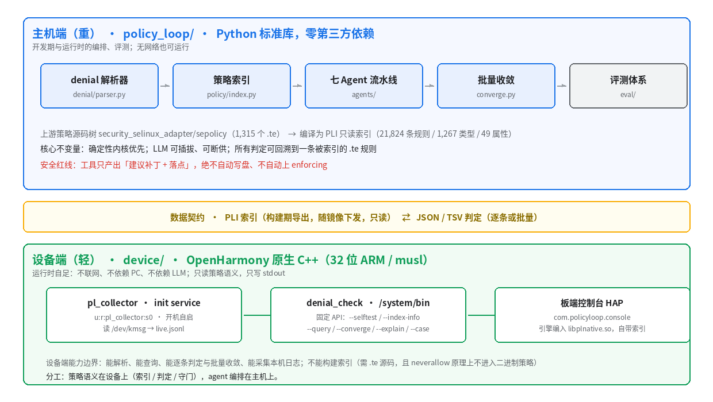
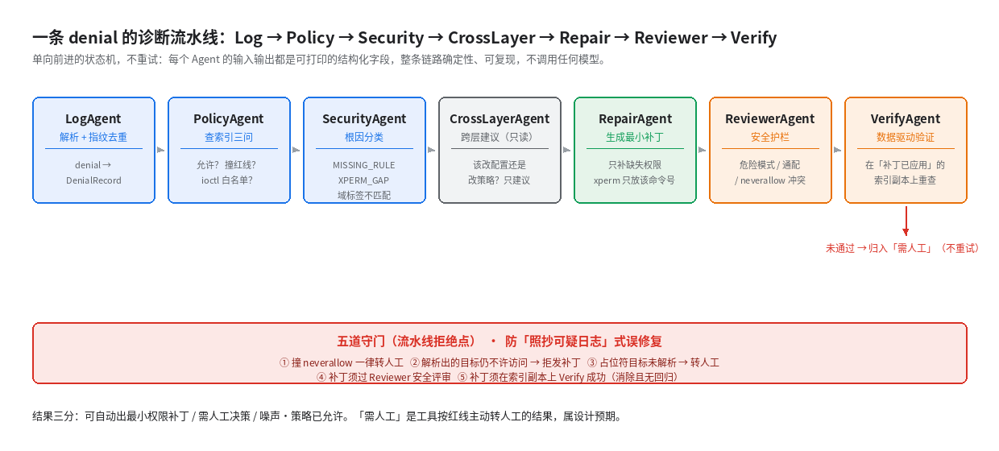
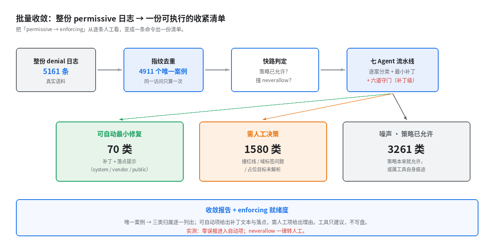
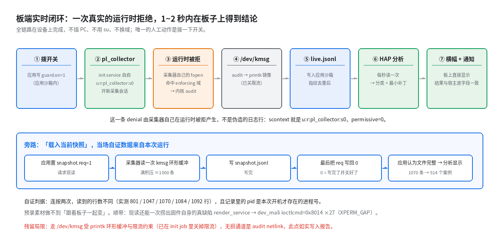
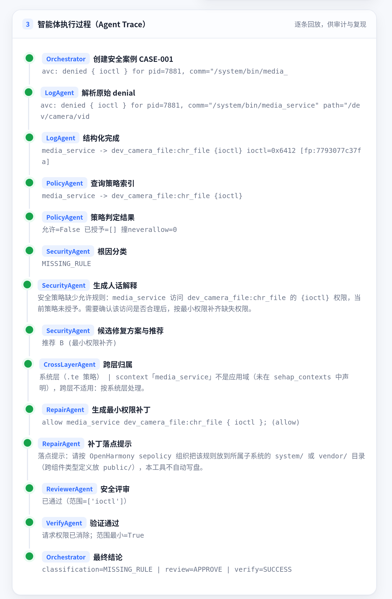
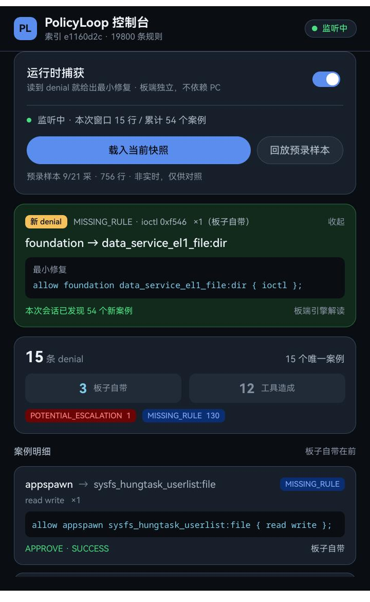
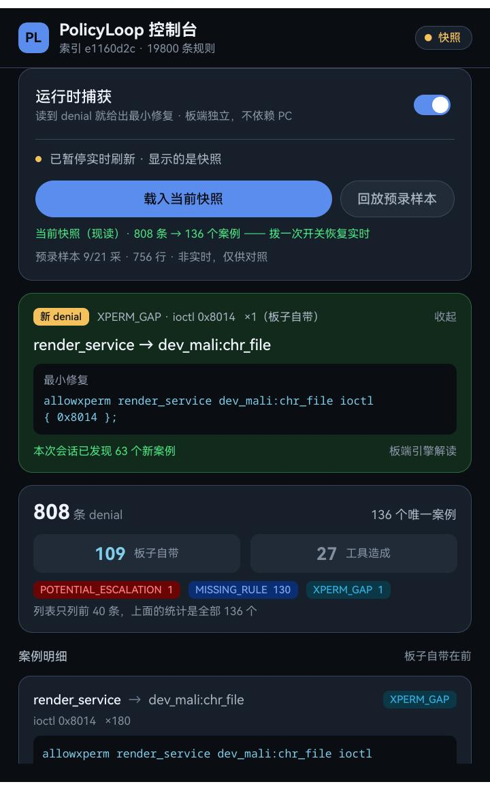
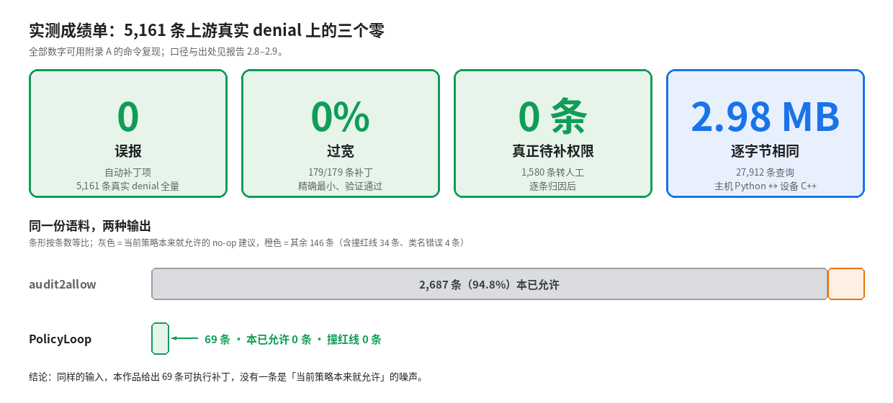

# 2026 开源鸿蒙大学生创新大赛 · 赛道一

**赛题：PolicyLoop（OpenHarmony SELinux 拒绝日志的最小权限自收敛）**

| | |
|---|---|
| 学校名称 | 华中科技大学 |
| 团队名称 | PolicyLoop 门禁团队 |
| 队长 | 苏子峰 |
| 队员 1 | 王子优 |
| 队员 2 | 曹灿 |

**一句话：让设备自己判 denial —— 主机与设备两次独立实现，2,984,884 B 输出逐字节相同。**

> 提交材料：① 参赛作品简介（另附）② 本开发设计文档 ③ 项目视频/PPT（另附）④ 可选辅助材料

---

## 目录

- [1 简介](#1-简介)
  - [1.1 背景](#11-背景) · [1.2 目的](#12-目的)
- [2 设计描述](#2-设计描述)
  - [2.1 总体设计](#21-总体设计) · [2.2 实现思路](#22-实现思路)
  - [2.3 系统结构](#23-系统结构) · [2.4 模块功能描述](#24-模块功能描述)
  - [2.5 业务/实现流程说明](#25-业务实现流程说明) · [2.6 接口描述](#26-接口描述)
  - [2.7 UI 设计](#27-ui-设计) · [2.8 实测与验证](#28-实测与验证) · [2.9 口径与诚实性说明](#29-口径与诚实性说明)
- [3 其他](#3-其他)
  - [3.1 成员分工](#31-成员分工) · [3.2 困难与思考](#32-困难与思考) · [3.3 不足与未来工作](#33-不足与未来工作) · [3.4 参考](#34-参考)

---

# 1 简介

## 1.1 背景

### 核心难点：不是“生成 allow”，是“敢不敢自动放权”

写一条“看到 denial 就加 `allow`”，一个下午就够。真正难的是三件事，本作品的绝大部分工作量花在这里：

1. **判定要对。** SELinux 的语义坑不在文档里：空权限是通配而不是空集、xperm 是大写敏感的不透明串、`permissive` 是三态、属性闭包和宏展开都要还原。
2. **判定要能证明。** 自造样本证明不了覆盖率，差分语料只证明“常见路径一致”；只有拿上游真实发生过的 denial 全量回放，数字才站得住。
3. **判定要落到设备上。** 板端没有 Python、没有编译器、没有构建系统；把 PC 脚本搬上去不算数。

### 评审只需要记住两件事

**一、判定跑在设备上，不是跑在 PC 上。**
板端是原生 C++ 系统组件 + 开机自启的 init service（自有 enforcing 域，不需要 PC、不需要 `su`、不需要 `begetctl`）。denial 出现后 1~2 秒，设备自己给出分类与最小补丁；拔掉 USB 重启，采集链路照样工作（2.8.5 / 3.2.7）。

**二、两套独立实现说同一句话，而且可以逐字节验证。**
主机 Python 与设备 C++ 是**两次独立实现**，喂同一份输入后，**27,912 条查询、2,984,884 B 输出的 sha256 完全相同**（2.8.4）。四个语义陷阱里错任何一个，哈希当场炸掉——这不是“我们觉得一致”，是二进制层面的证明。

这两件事分开看都不算新鲜，**合起来才难**：只做 PC 侧的工具没有设备端实现，只做设备端脚本的又通常拿不到 `.te` 源码与真实评测语料。本作品两边都做了，并且用逐字节差分把“两边一致”从断言变成可检验的事实。

> 其余工作（七 Agent、评测体系、文档门禁）都是为了让这两件事**站得住**，不是拿来凑数量。

**如果只记三个数**（口径见 2.8，全部可用附录 A 复现）：

- **0 误报** —— 5,161 条上游真实 denial 全量跑完，进入自动补丁项的案例零误报；
- **2.98 MB** —— 两套独立实现（主机 Python / 设备 C++）的 27,912 条查询输出逐字节相同；
- **0 条** —— 1,580 条“转人工”逐条归因，真正需要给设备补权限的是 0 条。

### 问题从哪来

OpenHarmony 用 SELinux 做强制访问控制：任何应用或系统服务要访问系统资源，都必须先过这道门禁。请求被拒时，内核会记录一条 `avc: denied` 日志：

```
avc: denied { read } for pid=2208 comm="media_service" path="/dev/video0"
     scontext=u:r:media_service:s0 tcontext=u:object_r:camera_device:s0
     tclass=chr_file permissive=0
```

这条日志对开发者极不友好，原因有三：

1. **读不懂**。`scontext` / `tcontext` / `tclass` / 权限位是一套自成一体的词汇，报错现场通常只看到“功能失败”，看不到“为什么”。
2. **不知道在哪补**。策略规则写在上千个 `.te` 文件里（实测 1,315 个），按子系统分目录；一条 denial 该落到 `system/` 还是 `vendor/`、属于哪个组件，靠经验。
3. **补不对**。最省事的做法是“看到 denial 就加一条 `allow`”，这会把一次越权尝试固化成永久授权。

现实中的应对往往是**把门禁关成“只记不拦”（permissive）**：系统看起来正常了，但实际处于**无强制拦截**状态。这是配置层面长期累积的安全债。

这个问题在 OpenHarmony 上游有充分的数据佐证。本作品对上游策略仓库 `security_selinux_adapter/sepolicy` 做了一次全量统计（`python -m policy_loop.eval.corpus`）：**1,315 个 `.te` 文件、51,427 行策略源码、378 个文件里留着 5,230 条 `avc: denied` 注释，索引规模 21,824**。

也就是说：**光是上游自己的代码注释里，就埋着 5,161 条真实发生过的 denial**。这些 denial 分布在全系统各子系统中，每一条当初都被人手工诊断过。这是一条靠人力堆砌、长期存在的工作流。

> **语料口径速查**（这几个数首次出现在这里，完整口径见 2.9）：原始注释条目 **5,230** 条 → 解析并与紧邻修复规则配对的 denial 记录 **5,161** 条（差 69 条是不与任何规则相邻、或没能解析成完整记录的注释；5,161 也是 `data/corpus/real_denials.txt` 的行数）→ 字段完整、可参与评测 **5,117** 条（44 条缺 `scontext`/`tclass` 等字段，回放时跳过）→ 指纹去重后的**唯一案例** **4,911** 个（`converge` 与各项评测的分母）。

## 1.2 目的

本作品的目标是把上面这条工作流自动化，并且**把“安全”作为一等约束而非事后检查**：

> 输入一份 `avc: denied` 日志，自动**读懂 → 定位根因 → 生成最小权限修复 → 安全评审 → 数据驱动验证**，最终支撑把设备从 permissive 收紧到 enforcing。

与“看到 denial 就加 allow”的常见做法相比，本作品要回答的是同一个问题的**更严格版本**：

- 常见做法问“这条访问**要**放行吗？”；本作品问“这条访问**该不该**放行？”撞系统红线的一律拒绝自动放权。
- 常见做法问“加哪条规则？”；本作品问“**最小**的那条规则是什么？”多一个权限位都算失败。
- 常见做法问“加完就行了吗？”；本作品还要回答“denial 消失了吗？有没有引入新的越权？”
- 常见做法一条一条看；本作品把整份日志一次收敛成可执行清单。
- 常见做法拿不准就写“转人工”；本作品把 1,580 条**逐条归因**“该谁修”（实测真正需要给设备补权限的只有 **0** 条）。

**验收目标是可量化的**，对应四组指标：策略覆盖率、补丁最小性、零越权（撞 neverallow 一律拒绝）、以及真机 enforcing 下的端到端一致性。

---

# 2 设计描述

## 2.1 总体设计

**一句话：重活在主机（索引、编排、评测），判定在设备（查询、守门、收敛），中间用一份只读索引和逐字节差分锁死。**

本作品按“能独立验证”划分成四层，每层都有明确的产出物与验收方式：

| 层 | 内容 | 产出物 | 验收 |
|:--------------------|:--------------------|:-----------------------------|:-----------------------|
| L1 确定性内核 | denial 解析器 + `.te` 策略索引 | `policy_loop/denial`、`policy_loop/policy` | 解析/查询差分逐字节一致 |
| L2 评测基线 | 从上游真实语料构造 golden 集并回放 | `data/eval/golden.jsonl`、`docs/eval-L2.md` | 覆盖率、可复现命令 |
| L3 诊断流水线 | 七 Agent 最小权限流水线 + 批量收敛 + 补丁最小化/归因 | `policy_loop/agents`、`converge.py`、`minimize.py`、`attribution.py` | 留一法回归、零过宽、闭环反验 |
| L4 设备端 | 系统组件 `denial_check` + 采集服务 + 控制台 | `device/`、板端 HAP | 真机五项门禁 |

四层的关系是**同一份判定逻辑的三次落地**：先在 Python 上把语义做对（L1–L3），再用评测证明它收敛（L2/L3），最后把它变成设备上的原生系统组件并用差分证明两端等价（L4）。

> **本作品总体架构**见图 1（2.3.1）。

## 2.2 实现思路

全部实现由下面四条原则推出，模块划分（2.4）与流程设计（2.5）都是它们的展开。

### 2.2.1 确定性内核优先，LLM 可插拔、可断供

解析、索引、根因分类、最小补丁、安全评审、验证：**全部是纯规则、纯标准库实现**，每个判定都能回溯到一条被索引的 `.te` 规则。LLM 只在配置了 key 时参与“人话解释/候选草稿”，**不参与任何安全决策**。

这个选择有直接的实验依据。本作品对同一批真实 denial 做了对照（`docs/eval-llm-guardrail.md`）：

| 方案 | 过宽（越权加权限）率 |
|---|---|
| 未受约束的“AI 直接放权”（naive 档，120 样本） | **100%** |
| PolicyLoop：最小权限指令 + 规则护栏 + 确定性精修 | **0%**（120/120 被拦截并精修回最小） |

**越权倾向是 LLM 的默认行为，提示词消除不掉，只能靠确定性护栏兜住**。架构上因此把“生成候选”和“批准授权”分成两个角色，后者永远是规则。

### 2.2.2 绝不自动写盘

工具只产出「建议补丁 + 落点提示（`system/` / `vendor/` / `public/`）」。是否写入 `.te`、是否重建策略、是否上 enforcing，由人决定。这条原则贯穿主机端与设备端：设备端的 `--explain` / `--case` 也只输出建议。

### 2.2.3 先仿真、后真机

先用上游真实策略语料做数据仿真与量化评测（成本低、可反复），再上真机取独立证据。真机给出的是**独立于评测构造的第三类证据**。

### 2.2.4 设备端只搬“属于设备的那一段”

这是本作品最关键的一个架构判断，也是最常被问到的一点：**为什么不把整个 PolicyLoop 移植到设备上？**

其中一部分原理上无法下沉：

- **设备上没有策略源码。** 实测设备上 SELinux 的全部家当是 `config`（enforcing）+ 编译后的二进制 `policy.31`（424,699 B）+ 若干 `*_contexts` 文本；`find /system /vendor -name "*.te"` **为空**。
- **`neverallow` 原理上不在二进制策略里。** `neverallow` 是**编译期断言**。`third_party/selinux/libsepol/src/expand.c:2736` 的注释写明：neverallow 规则不写进产出的策略，只在编译期留给断言检查器核对。而本工具的核心守门之一就是“撞 neverallow → 拒绝自动放权”（策略里实测 419 条 `neverallow` + 11 条 `neverallowxperm`）。设备上拿不到红线，工具会退化成“看到 denial 就建议放权”，而这是它最该避免的行为。
- **多智能体编排与评测工具本就属于开发期**，不是运行时设备功能。

因此分工明确：**策略语义在设备上**（索引 / 判定 / 守门），**agent 编排在主机上**。索引由构建期从源码树导出为只读的 **PLI** 数据文件（本作品自定义的索引格式：`PolicyIndex` 的文本化只读投影，首行即格式魔数 `PLI1`、次行 `@rev` 是版本号，见 2.6.2）随镜像下发。这属于架构约束。

## 2.3 系统结构

### 2.3.1 模块划分



系统分为**主机端（重）**与**设备端（轻）**两侧，中间是一条窄接口：

- **主机端**（Python 标准库，零第三方依赖）：denial 解析器、策略索引、七 Agent 诊断流水线、批量收敛、评测体系。
- **设备端**（OpenHarmony 原生 C++，32 位 ARM / musl）：采集服务 `pl_collector`、系统组件 `denial_check`、板端控制台 HAP。
- **数据契约**：PLI 只读索引（构建期导出、随镜像下发）+ JSON/TSV 判定结果（逐条或批量）。

分层依据是**“哪些能力必须和设备在一起”**：只有需要读内核日志、需要独立于 PC 运行的部分才下沉；策略语义（索引 + 判定 + 守门）下沉是因为“设备自己的策略缺口是它自己的事实”；而索引的**构建**不能下沉，因为需要 `.te` 源码。

> 两个备选方案均未采纳。**全部做成上位机工具**满足不了“系统组件”的定位，也无法在无 PC 的现场使用。**全部下沉到设备**受制于 `neverallow` 不在二进制策略中这一硬约束，且会把开发期工具塞进系统镜像。

### 2.3.2 系统架构说明

一条 denial 在系统中的完整动线，是七个 Agent 依次处理的一条**单向链**（`Log → Policy → Security → CrossLayer → Repair → Reviewer → Verify`）；其中 `CrossLayerAgent` 只出跨层建议、不改变结论：



`Orchestrator` 是一个严格状态机：`Log → Policy → Security → CrossLayer → Repair → Reviewer → Verify`。每个 Agent 的输入输出都是可打印的结构化字段（`SecurityCase` 记录全程 trace），因此整条链路可复现、可单测。流水线**刻意不含回路**：`VerifyAgent` 判失败、或 `ReviewerAgent` 否决时，该案例被归入「需人工」，而**不会回退到 `RepairAgent` 重算**，因为允许 Agent 反复重试到某次通过安全门，等于让它迭代出一个更宽的补丁（详见 2.4.3）。

业务处理上，主机端与设备端共享同一套判定语义：设备端的 `--converge`（批量报告）与 `--case`（逐条判定）**走同一份判定代码**（`ExplainCase` + `ApplyGuards`），因此两条路径的答案不会漂，这一点由差分门禁逐字段验证（见 2.8）。

### 2.3.3 文件结构

```text
policy_loop/
├── policy_loop/                      主机端引擎（Python 标准库，零第三方依赖）
│   ├── denial/parser.py              AVC denial 解析 + 指纹去重
│   ├── policy/
│   │   ├── index.py                  .te 策略索引与查询（allow/neverallow/allowxperm）
│   │   ├── cross_layer.py            APL（应用能力特权级）跨层反查
│   │   ├── cil.py                    板子 policy.31 反编译 CIL 的只读视图
│   │   └── sehap.py                  sehap_contexts 解析
│   ├── agents/                       七 Agent 流水线
│   │   ├── orchestrator.py           严格状态机
│   │   ├── security_case.py          案件档案 + Agent Trace
│   │   ├── log_agent.py / policy_agent.py / security_agent.py
│   │   ├── repair_agent.py / reviewer.py / verify_agent.py
│   │   ├── cross_layer_agent.py      跨层判定（advisory）
│   │   └── providers.py              可插拔 LLM Provider
│   ├── eval/                         评测体系
│   │   ├── corpus.py / extract.py    语料统计 / golden 抽取
│   │   ├── replay.py                 索引覆盖回放
│   │   ├── trust.py                  golden 可信度质检
│   │   └── agent_eval.py / agent_llm_eval.py   留一回归 / LLM 护栏对比
│   ├── export/pli.py + cli.py        PLI 索引导出器
│   ├── converge.py                   批量收敛（整份日志 → 三分清单）
│   ├── minimize.py                   补丁集根因归并 + 闭环反验 + 爆炸半径
│   ├── attribution.py                「需人工」1580 条的根因归因（该谁修）
│   ├── explain.py                    单条诊断
│   └── selfcheck.py                  环境 + 模块 + 冒烟自检
├── webui/server.py                   Web UI（stdlib HTTP server + /api/analyze）
├── device/                           设备端（按 OpenHarmony 源码路径镜像）
│   ├── selinux_adapter/
│   │   ├── framework/policycoreutils/src/pl_*.cpp      核心库（6 个编译单元）
│   │   ├── framework/tools/denial_check/test.cpp       命令行外壳与固定 API
│   │   └── interfaces/policycoreutils/include/pl_*.h   接口（7 个头文件）
│   ├── patches/selinux_adapter-BUILD.gn.patch          对上游 BUILD.gn 的加法
│   ├── selinux_policy/                                 域策略、安装与自检脚本
│   │   ├── pl_collector.cil / denial_check.cil
│   │   ├── build_policy.sh / build_pl_collector.sh
│   │   └── install_service.sh / install_to_board.sh / diag_domain.sh
│   ├── board/                                          板端 init 配置与运维脚本
│   │   ├── policyloop.cfg / policyloop-probe.cfg
│   │   └── pl_guard.sh / pl_domtest.sh
│   ├── pl_console/                  板端控制台 HAP 工程（ArkTS+NAPI，内置索引）
│   └── install.sh                                      铺回 OH 源码树
├── tools/                            devbuild.sh / build_hap.sh / make_app_icon.py …
├── data/
│   ├── corpus/real_denials.txt       真实 denial 语料（5,161 条）
│   ├── eval/golden.jsonl             自证评测集（3,367 对）
│   ├── eval/golden.trusted.jsonl     质检后干净子集（2,154 对）
│   ├── reports/                      各项评测报告（已入库）
│   └── fixtures/                     测试与演示样例
├── docs/                             设计与评测文档、配图
└── tests/                            单测套件 + 设备差分门禁 diff_device.py
```

> **可复现性**：板端控制台 HAP 的工程源码就在仓内 `device/pl_console/`，`tools/build_hap.sh` 的 `PROJ` 默认指向它，`tests/test_tool_domains_sync.py` 会校验两份工具域清单一致（不一致即测试失败）。构建可离线完成，只有签名（需本机 UDID）与装机（需 hdc）依赖板子。

## 2.4 模块功能描述

> **本节导读**：十节里决定作品成色的只有三处——2.4.2（红线覆盖面，决定敢不敢自动放权）、2.4.3（七 Agent 单向链、无回路）、2.4.5（补丁最小化 69→54、闭环反验 70→0）。其余几节是按交付模板逐项说明。

### 2.4.1 denial 解析器（`policy_loop.denial.parser`）

- **标识**：`policy_loop.denial.parser`
- **类型**：数据解析模块
- **目的**：把内核输出的、面向机器而非面向人的 AVC 日志，转成结构化记录。
- **功能列表**：解析 OH 专有形态（`parameter_service` 的 `parameter=`、`samgr_class` / `hdf_devmgr_class` 的 `service=`/`sid=`、`ioctlcmd=0x…`、`permissive` 标志、`audit:`/`avc_audit_slow:` 前缀、续行、多事件切分）；计算**指纹**用于跨批次去重。
- **处理**：纯正则 + 状态机，无外部依赖。`permissive` 按**三态**建模：`0` = 已拦截、`1` = 只记不拦、**其余取值与字段缺失一律为「未知」**。三态在计数上分开（`permissive_unknown` 独立统计），在收敛判定上则**一律走保守侧**：只有 `1` 会被判为历史噪声，未知态与 `0` 同样转人工复核（`DOMAIN_OR_LABEL_MISMATCH`），**绝不参与自动放权**。指纹去重是批量收敛的基础：它让“同一访问重复被拒上千次”收敛成一个案例，也让真机验收指标**天然免疫 printk 丢帧**（见 3.2）。

### 2.4.2 策略索引（`policy_loop.policy.index`）

- **标识**：`policy_loop.policy.index`
- **类型**：策略语义模块
- **目的**：在主机上把 `.te` 源码树编译成可查询的索引；在设备上加载同一份索引的只读投影（PLI）。
- **功能列表**：解析 `allow` / `allowxperm` / `neverallow` / `neverallowxperm`；计算 attribute 闭包（含 `typeattribute` 的空格/逗号两种写法）；展开宏（`binder_call()` 等）与条件块（`debug_only()` 等）；ioctl 白名单/xperm 语义判定。
- **处理**：查询接口三个：`has_access`（请求权限是否**全部**被授予）、`neverallow_rules`（红线）、`ioctl_allowed`（白名单判定）。另有 `resolve_logical_target`：把 `default_service` / `default_hdf_service` 这类**占位目标**按具名服务或自注册 `add` 确定性映射到 `sa_*` / `hdf_*` 具体类型。

实测索引规模（上游 1,315 个 `.te`，`sepolicy@29a2fc123dd1`）：**21,824 条规则、1,267 个类型、49 个属性**，其中 `allow` 20,758、`neverallow` 419、`allowxperm` 636、`neverallowxperm` 11，另有 524 条语句进了 `skipped` 计数（172 条宏/条件调用未展开、147 条 `allow`/`allowxperm` 与 **140 条 `neverallow`/`neverallowxperm`** 因写法不被三条正则接受、8 条 `dontaudit` 这类刻意不建模的语句、其余是宏定义体残片等）。

> **索引的红线覆盖面**：同一棵树上以 `neverallow` / `neverallowxperm` 开头的语句共 **570 条**，索引实际收进 **430 条**（即上句的 419 + 11）。被拒的 **140 条**按形态分：类位写成集合 `:{ c1 c2 }` 59 条（如 `neverallow { chipset_domain } system_file:{ blk_file chr_file … } *;`）、权限位取反 `~{ search }` 或 `~list` 50 条、目标位取反 `~{ attr … }`（源位或目标位）9 条、xperm 单值未加花括号 1 条 —— 这 **119 条是纯书写形态**，放宽三条正则即可收（1 行级改动）；余下 **21 条**的类型集合里嵌着条件宏（`debug_only(…)`），即便放宽正则也只能「看条件」，与部署期被跳过的 88 条条件式红线同类。宿主与设备之间的差分门禁**原理上抓不到**前者：设备侧读的是宿主导出的 PLI，`skipped` 在两端都只报不查，而聚合数字（分类分布、补丁行数）不变——总量会盖住单案翻转。处置见 2.9 与 `docs/known-limitations.md` §2.1：**未修**（改它会动索引规模、PLI 与随镜像下发的索引，板子不在线时不做）。

### 2.4.3 七 Agent 诊断流水线（`policy_loop.agents`）

- **标识**：`policy_loop.agents`
- **类型**：业务编排模块（确定性，无模型调用）
- **目的**：对**一条** denial 给出完整结论：根因是什么、策略红线在哪、最小补丁是什么、能不能自动落地。
- **功能列表 / 处理**：

| Agent 与职责 | 判定输出 |
|:-------------------------|:-----------------------------|
| **LogAgent**：解析、指纹去重 | `DenialRecord` |
| **PolicyAgent**：查索引三问——允许？撞红线？ioctl 白名单？ | 策略裁决 |
| **SecurityAgent**：根因分类 | `MISSING_RULE` / `XPERM_GAP` / `POTENTIAL_ESCALATION` / `NOISE_OR_ALREADY_FIXED` / `DOMAIN_OR_LABEL_MISMATCH` |
| **CrossLayerAgent**：跨层建议（**只读**，advisory） | 该修在 `module.json` 还是 `.te`；只出建议、**不改变结论**（Repair 及其后忽略它） |
| **RepairAgent**：生成最小权限补丁 | 普通 `allow` 只补缺失权限；`allowxperm` 只放行该命令号 |
| **ReviewerAgent**：安全护栏 | 危险模式 / 越权放行 / 通配 / neverallow 冲突 → APPROVE / REJECT |
| **VerifyAgent**：在“补丁已应用”的索引副本上重查 | 消除、无回归、范围最小 → SUCCESS / FAILED / SECURITY_REGRESSION |

- **跨层判定的实现**：`CrossLayerAgent` 读取 8 份 `sehap_contexts` 建立 **APL**（Ability Privilege Level，应用能力特权级）反查，区分“应用域/系统域”，让应用级与系统级的排查链路分开。它插在 Security 与 Repair 之间，**读裁决但不写裁决**，加不加它，同一条 denial 的结论都不变（见 `agents/orchestrator.py` 的 `_PIPELINE`）。
- **流水线不含回路**：`Orchestrator.analyze()` 对 `_PIPELINE` 单向前进，**唯一的提前退出是 log 解析失败**；Reviewer 否决或 Verify 判 `FAILED`/`SECURITY_REGRESSION` 时，该案在 `converge` 里由 `_categorize()` 归入「需人工」，**不回到 Repair 重算**（理由见 2.3.2）。

### 2.4.4 批量收敛（`policy_loop.converge`）

- **标识**：`policy_loop.converge`
- **类型**：批处理工作流
- **目的**：把“permissive → enforcing”从逐条人工看，变成一条命令出一份清单。
- **功能列表**：整份日志 → 指纹聚类去重 → 快路判定（策略已允许？撞 neverallow？）→ 每唯一案例跑一遍 Agent 流水线 → 输出**收敛报告**（去重比、根因分布、可自动最小修复的补丁集、需人工项、enforcing 就绪度）。
- **处理：五道守门**（防“照抄可疑日志”式误修复）：

| # | 守门 | 作用 |
|---|---|---|
| 1 | 撞 `neverallow` → 直接转人工 | 拒绝自动放权 |
| 2 | 解析出的目标仍不许访问 → 拒发补丁 | 拦住“解析成功但补丁仍写占位符”的情形 |
| 3 | 占位符目标未解析 → 转人工 | 不猜 |
| 4 | 补丁须过 Reviewer 安全评审 | 广度过宽/危险模式拦截 |
| 5 | 补丁须在索引副本上 Verify 成功 | 必须真的消除且无回归 |

> **注意**：别把这张表与代码里的 `apply_guards` 混为一谈，它们是两套分法、数也不同：
> 这里是**流水线里的 5 个拒绝点**（含 Reviewer / Verify），代码里的 `apply_guards`
> 是**另一组 6 个分支**（MLS 级目标 / `default_*` 占位符 / 主体或目标不在语料 /
> 对象类不在语料 / 权限位含非权限名 / 空权限补丁）。后者才是 converge 与 `--explain`
> **共用的那一份**：同一份实现、两个调用点，同一条记录从哪个入口问都必须拿到同一句话
> （见 `eval-converge.md`）。

### 2.4.5 补丁最小化与闭环反验（`policy_loop.minimize`）

- **标识**：`policy_loop.minimize`
- **类型**：批处理后处理（**只在宿主机跑**，不改设备端一个字节）
- **目的**：`converge` 回答的是**逐案例**的问题：“哪一条规则能关掉这一个案例？”。这对看单个案例的人是对的，对看整份日志的人是错的：两个案例只要内核打印权限的次序不同，就会被投影成两条规则，而它们其实是同一个根因。实测例：`allow init write_updater_exec:file` 的 `{ execute }` / `{ map }` / `{ open read }` 三条，是三个 cluster、一个根因，*init 本不该引用这个 updater 二进制*。
- **功能列表**：
  - **根因归并**：重读收敛报告，把同一 `(src, tgt, cls)` 的补丁行并成一条根因规则，
    并记录它**关闭了哪些案例**、是**扩了已有规则**还是**新增**。
  - **闭环反验**：把归并后的规则集套回索引的副本上**重新查询**，要求
    “补丁前未解决的案例，套回后全部解决”，且“套回前它们确实没被解决”。
    `converge` 只断言补丁**编译得过**；这一步断言补丁**真的有用**。
  - **爆炸半径**：每条规则给出 `BlastRadius`，即展开后实际受影响的类型数与规则数。
    **注意**：判定“最窄规则”必须按**展开后的影响面**，不能按 token 数：
    `{domain}` 只用 1 个 token，却覆盖 **235** 个类型。

- **输出**：`rules`（最小规则集 + 关闭的案例 + 爆炸半径）、`verify`（闭环结论）、
  `--cil`（给 `secilc` 与 neverallow 门禁用）、`--patch-report`（喂给
  `tools/apply_converge.py`，供红线门禁验证归并后的集合）。
- **实测**：补丁 **69 行 → 54 条根因规则**（归并 10 组、省 15 行；26 条折叠进已有规则，
  其中 3 条会波及属性成员；25 条为新增），闭环反验 **70 未解决 → 0**。

### 2.4.6 策略级根因归因（`policy_loop.attribution`）

- **标识**：`policy_loop.attribution`
- **类型**：批处理后处理（只读，不产生补丁）
- **目的**：`converge` 把 4,911 个唯一案例分成三类，其中 **1,580 个进 `needs_human`**，
  占三分之一，而它对这些案例说的话只有一句「转人工」。对着一屏“转人工”，读者学到的
  是**工具不知道**，而不是工具知道什么。本模块把那 1,580 条逐条问出根因，
  **判据全部是可证伪的查询**（问板子自己的 `policy.31` 反编译视图、问上游树、
  问日志字段是否完整），不引入启发式。
- **功能列表**：读收敛报告里判不了的那部分，逐条问出根因并落到一个 owner，残留数不为 0 即以非零码退出。
- **处理：每条案例落到一个 owner**：

| owner | 含义 | 实测 |
|:------------|:--------------------------------------------------|:-----------|
| `DEVICE` | 板上真要补权限（**唯一**需要打补丁的一类） | **0** |
| `TOOL` | 工具侧该修（索引/版本对齐、语料收录） | 342 |
| `LOG` | 采集/日志质量（缺字段、上下文畸形） | 53 |
| `HUMAN` | 需要架构决策（撞 neverallow 红线） | 38 |
| `NONE` | 无需动作（现在已允许） | 1,147 |

> **结论**：1,580 条「转人工」**一条不漏地**落到表里的五个 owner；真正需要给板子补权限的是 **0 条**。也就是说，“转人工”不等于“缺口”，此前被当成缺口的数字里，约 73% 是语料历史噪声。

- **退出码即判据**：`0` 仅当残留 `UNATTRIBUTED` 为 0，**归因不完备就失败**，
  不许悄悄漏掉。实测 1,580 → 归因 1,580、残留 **0**。
- **主动证伪的三类根因**：板子策略里 `(boolean` 出现 **0** 次、`(constrain` **0** 次、
  `(mlsconstrain` 只有 **1** 条且只约束 `(filesystem (relabelto))`。所以“boolean 未开”、
  “constraint 拦下”、“MLS 级不匹配”在本平台**原理上无从发生**，把它们列进报告当
  “检查过了”站不住，本模块选择**写明证伪**。

### 2.4.7 评测体系（`policy_loop.eval`）

- **标识**：`policy_loop.eval`
- **类型**：开发期验证工具（**不随设备发行**）
- **目的**：让所有结论可量化、可复现、可被质疑。
- **功能列表**：
  - `corpus`：语料规模统计；
  - `extract`：从上游 `.te` 的 `# avc: denied …` 注释与其紧邻修复规则，按邻接配成 `(denial → 真实修复)` 对，产出 golden 集（3,367 对）；
  - `replay`：全量索引下这些真实 denial 是否已被允许，测索引/属性/宏处理的**召回**；
  - `trust`：逐对校验“规则与 denial 是否真的相关”，过滤邻接配对的错配噪声，产出 trusted 干净子集；
  - `agent_eval`：**留一法**回归，即剔除某 denial 的修复规则使其回到“未修复”，再跑 Agent 流水线，比对生成补丁；
  - `agent_llm_eval`：同批 denial 上让 LLM 自由起草补丁，量化越权率与护栏拦截率。

### 2.4.8 设备端组件 `denial_check`（`device/`）

- **标识**：`denial_check`，安装于 `/system/bin/denial_check`
- **类型**：OpenHarmony 原生可执行程序（32 位 ARM / musl 动态链接）
- **目的**：**审计设备自己的策略，应该是平台能力，而不是一件必须先有 PC 和串口线才能做的事。**
- **功能列表 / 处理**：
  - 核心是一个**独立静态库** `libdenial_check_core`（6 个编译单元），`external_deps` 为空，即它只能链到 `libc`/`libc++`/`libm`，**不得**引入 hilog 或 libselinux。原因是它的全部意义就在于“在任何能读到输入的域下运行，并把结论写 stdout 而不是写 hilog”。这条规则是**可检查的**，不是声明。
  - 固定 API 入口：`--selftest` / `--index-info` / `--query` / `--dump-denials` / `--converge` / `--explain` / `--case`。
  - `--explain` 另带 `--cross-layer`（显式打开跨层视图，需索引含 `@hap` 段）；不给就只有默认契约。
  - **`--explain` 与批处理走同一份守门**：设备端只有一个 `ApplyGuards`，单条诊断与
    批量收敛调的是它。理由同上：守门若只内联在批量聚类循环里，
    `--explain`（开发者捏着一条坏日志时最先用的那条路）就会推荐一条**编译得过、
    Verify 也判成功、只是落不了地**的规则（实例：对着 `default_service` 写
    `allow X default_service:samgr_class { get };`）。同一条记录从哪个入口问，
    都必须拿到同一句话。
  - **两条路径都进自检**：`--selftest` 内嵌一份 11 条规则的小策略与 26 条 denial，
    比对 24 组收敛向量 + 11 组解释向量（后者按**整份 JSON** 比，其中 6 组 `advisory`
    非空）。两条路径**分别**钉住：把 `--explain` 路径上的 `ApplyGuards` 调用删掉，
    解释向量 6/11 报错而收敛向量 24/24 全绿：收敛向量结构上看不见解释路径，所以
    这不是同一批断言换个写法。六道守门在收敛向量里**一道不缺**。
  - **`@hap` 进索引**：`sehap_contexts` 的 APL↔域桥表随 PLI 下发，设备端才能复现
    跨层结论（“这是 APL 分级边界” vs “这是漏配的规则”）。该表共 17 条 APL↔域映射、
    覆盖 13 个域，随 PLI 一并下发。
  - **绝不写盘**：只输出建议补丁文本。

> **一句话**：设备端不是宿主的缩水版——它用同一份守门、同一批自检向量，输出与宿主逐字节相同（2.8.4）。

### 2.4.9 板端采集服务 `pl_collector`

- **标识**：`pl_collector`，init service（`/system/etc/init/policyloop.cfg`）
- **类型**：系统服务（OpenHarmony init 托管）
- **目的**：让采集不再依赖 PC、`su`、`begetctl`，开机即在。
- **功能列表**：开机自启；运行在**自己的 enforcing 域** `u:r:pl_collector:s0`（无 permissive 兜底）；读 `/dev/kmsg` → 指纹去重 → 写应用沙箱内的 `live.jsonl`；响应控制台的“现读快照”请求。
- **处理**：域策略已 persist 到磁盘，重启仍生效（实测重启后 `up 0 min` 时服务已在域内采集，开机以来本域 denial = 0 条）。

### 2.4.10 板端控制台 HAP

- **标识**：`com.policyloop.console`
- **类型**：OpenHarmony 应用（HAP）
- **目的**：让“设备自己给自己出结论”这件事可见、可演示。
- **功能列表**：开关切换采集会话；每秒读一次 `live.jsonl` 并分析；显示分类 + 最小修复 + 评审/验证结论；系统通知；「载入当前快照」现读 `/dev/kmsg` 现存积压。
- **处理**：**引擎直接编进 `libplnative.so`**，索引编在 HAP 的 rawfile 里，因此**拔掉 USB 也能独立运行**，结果与宿主逐字段一致。

## 2.5 业务/实现流程说明

### 2.5.1 用例 1：单条 denial 的诊断流水线

**参与对象**：`Orchestrator`（状态机）→ 依次执行的七个 Agent（其中 `CrossLayerAgent` 只读）→ `PolicyIndex`。

**流程概览**：流水线的结构见 [2.3.2 图 2](#232-系统架构说明)（七 Agent 诊断流水线）。逐步展开为：

1. `LogAgent` 解析日志行，产出 `DenialRecord` 与指纹；
2. `PolicyAgent` 查索引：该访问当前**是否已被允许**？是否**撞 neverallow**？若是 ioctl，白名单里有没有这个命令号？
3. `SecurityAgent` 依据上一步的裁决做根因分类；
4. `RepairAgent` 生成补丁：普通 `allow` 只补缺失权限，`allowxperm` 只放行该命令号；
5. `ReviewerAgent` 安全评审：广度过宽、危险模式、与红线冲突 → REJECT；
6. `VerifyAgent` 在“补丁已应用”的索引副本上重查：denial 是否消除、有无回归、范围是否最小；
7. 若验证失败（或第 5 步被否决）→ 该案例归入「需人工」，**不回到第 4 步重算**。

**典型反例（说明守门的价值）**：设备上有 `render_service → dev_mali:chr_file { ioctl } ioctlcmd=0x8014` 的稳定复发 denial。策略**已经允许了 ioctl 大类**，缺的只是 `allowxperm` 白名单里的**一个命令号**（`XPERM_GAP`）。此时“看到 denial 就加 allow”的工具会建议加一条**已经存在**的规则（写了等于没写），而本作品给出的是：

```
allowxperm render_service dev_mali:chr_file ioctl { 0x8014 };
```

### 2.5.2 用例 2：整份日志的批量收敛



**参与对象**：`converge` → `LogAgent`（去重）→ 快路判定 → 七 Agent 流水线 → 报告。

**实测（本机，2026-10-05 复跑）**：

```
$ python -m policy_loop.converge --log data/corpus/real_denials.txt \
      --policy data/raw/oh-selinux/sepolicy --json /tmp/converge.json
日志 5161 条 → 去重后 4911 个唯一案例（噪声/已允许 3261）。
其中 70 类可自动出最小权限补丁、1580 类需人工决策（占唯一案例约 32%）。
real 0m4.161s
```

根因分布：`DOMAIN_OR_LABEL_MISMATCH` 1,461 / `NOISE_OR_ALREADY_FIXED` 3,261 / `MISSING_RULE` 148 / `POTENTIAL_ESCALATION` 38 / `XPERM_GAP` 3。

**观察**：全量 5,161 条里 **零误报**进入自动项；`neverallow` 一律转人工。因此“需人工决策”的 1,580 类是工具**主动拒绝越权**的结果，其构成见 2.4.6 的归因表。

### 2.5.3 用例 3：板端实时闭环演示



**参与对象**：控制台 HAP（应用沙箱）→ `pl_collector`（init service）→ 内核 audit → `/dev/kmsg`。

**动线**：拨一下开关 → 采集器开启新会话 → 它自己的那次 `fopen` 命中 enforcing 域被拒 → 内核 audit → `/dev/kmsg` → `pl_collector` 写入应用沙箱的 `live.jsonl` → HAP 每秒分析 → 横幅 + 系统通知。**唯一的人工动作是拨开关。**端到端时延约 1~2 秒，由两个 1 秒的轮询叠加而成：`pl_guard.sh` 每秒查一次 `guard.on`（`sleep 1`），HAP 侧每秒读一次 `live.jsonl`（`Index.ets` 的 `POLL_MS = 1000`）。拨动后最坏情况要等采集器下一轮才发现开关已开，再等应用下一轮才读到新行。

**这条 denial 是真的**：它由采集器自己在运行时被拒产生（`scontext=u:r:pl_collector:s0`、`permissive=0`、域为 enforcing），不是伪造的日志行。做成**运行时参数**（`--debug-log <path>`）而非编译期开关，是为了让交付的二进制只此一份，是否触发纯属**部署选择**。

**两个来源在界面上分开标注**：主按钮「载入当前快照」为**现读**，小字链为**预录样本**。区分二者的判据是“这份文件会变”：连按两次读到**不同的行数**（实测 801 / 1047 / 1070 / 1084 / 1092 行），且记录里的 `pid` 是本次开机才存在的进程号，`<开机微秒>` 与 `/proc/uptime` 对得上。

## 2.6 接口描述

### 2.6.1 调用接口（本系统使用到的周边接口）

| 接口 | 方向 | 说明 |
|:----------------------------|:-----------------|:----------------------------------------------|
| `/dev/kmsg` | 读 | 内核 audit 记录镜像给 printk 的那份副本；采集服务的输入源 |
| 二进制策略 `policy.31` + `*_contexts` | 读 | 设备上 SELinux 的全部家当；只读，不修改 |
| 上游 `.te` 源码树 | 读 | 主机端构建 PLI 索引的输入（设备上没有） |
| 内核策略装载（CIL） | 写（部署期） | 安装脚本经 `checkpolicy`/`secilc` 把域策略编译并装载 |

### 2.6.2 提供接口（本系统对外提供的接口）

| 接口 | 形态 | 说明 |
|:--------------------------|:--------------------|:----------------------------------------------|
| **PLI 索引** | 文本数据文件 | 构建期导出、随镜像下发的只读策略投影（含规则、类型、属性、`@hap` 段） |
| `denial_check` CLI | 命令行 | 固定 API：`--selftest` / `--index-info` / `--query` / `--dump-denials` / `--converge` / `--explain` / `--case`（`--explain` 可加 `--cross-layer`） |
| `--case` 逐条判定 | 行式 JSON/TSV | 一行一条已拆好字段的记录进，一行一个 JSON 判定出；**只输出建议，绝不写盘** |
| 收敛报告 | JSON | 字段与宿主引擎逐个相同，可直接 `diff` |
| Web UI | HTTP | `python -m webui.server` 提供 `/api/analyze` 与 Agent Trace 前端 |
| 板端控制台 | HAP | 开关 + 实时视图 + 快照现读 |

## 2.7 UI 设计

本作品有两处界面：

1. **主机端 Web UI**（`webui/server.py`，标准库 HTTP server）：单页展示 Agent Trace 动画与结果卡片，输入一条 denial 即可看到七个 Agent 的可视化过程。
2. **板端控制台 HAP**：顶部开关（切换采集会话）、状态行（`本次窗口 N 行 / 累计 M 个案例`）、案例卡片区（分类 / 最小修复 / `APPROVE · SUCCESS` / 来源标注）、主按钮「载入当前快照」与预录回放链。

**设计原则**：界面必须**如实区分数据来源**，工具造成的 denial 会明确标注「工具造成」，不冒充分析结果；“累计案例”与“本次窗口行数”分开计数，因为它们测的不是一回事。



{width=13cm}

{width=13cm}

## 2.8 实测与验证

> 本节只保留最能说明问题的数字；完整口径与边界集中在 2.9，所有数字均可用附录 A 的命令复现。

### 成绩单：六个数字

**0 误报**　5,161 条上游真实 denial 全量跑完，进入自动补丁项的案例零误报。

**0% 过宽**　179/179 精确最小；同一批样本交给未受约束的 LLM，过宽率 100%。

**99.94%**　干净子集 3,522 条真实 denial，索引未覆盖仅 2 条。

**2,984,884 B**　27,912 条查询，主机 Python 与设备 C++ 两份独立实现输出逐字节相同。

**0 条**　1,580 条“转人工”逐条归因，真正需要给设备补权限的是 0 条。

**69 vs 2,833**　同一份语料：本作品给出 69 条补丁、no-op 0 条；`audit2allow` 给出 2,833 条，其中 2,687 条（94.8%）本已允许。



### 和现有工具比：同一份语料，69 条 vs 2,833 条

同样的输入交给 `audit2allow`，它给出 **2,833 条** allow；其中 **2,687 条（94.8%）是当前策略本来就允许的**，**34 条撞 neverallow**，4 条引用了不存在的类名。本作品给出 **69 条**（根因归并后 54 条），**误报 0、过宽 0、撞红线 0**。

| 指标 | audit2allow | 本作品 |
|:---------------------------|:-------------------|:--------------------------------------|
| 输出规则数 | 2,833 条 | **69 条**（根因归并后 54 条） |
| 其中当前策略本来就允许的（no-op） | 2,687 条（94.8%） | **0 条** |
| 撞 neverallow | 34 条 | **0 条**（一律转人工） |
| 引用不存在的类名 | 4 条 | **0 条**（转人工） |

> **这张表是全文最该记住的对比**：多数工具在“多给权限”这一侧工作，本作品在“少给、且给对”这一侧工作。

### 2.8.1 索引召回：干净子集 99.94%

**3,522 条真实 denial 里，索引只漏了 2 条（都是 `samgr_class`）。**

全量 5,117 条可评测样本的覆盖率是 **97.19%**，低下去的部分来自“注释与紧邻修复规则”配对噪声；质检剔除 1,213 对错配后，干净子集 3,522 条的覆盖率是 **99.80%**，再把 `service` 占位目标解析后是 **99.94%**。分母换了，不是数字改小了（口径见 2.9）。

### 2.8.2 最小权限修复：179/179 精确最小，221/221 全部拦下

**该补的 179 条全部精确最小，该拦的 221 条全部拦下——留一法下没有一次方向性错误。**

方法：剔除 golden 中该 denial 的真实修复规则，让它回到“未修复”，再跑流水线比对补丁。1,915 个 informative 样本中抽样 400（`seed=0`）：

- 应生成补丁的 **179 条**：`exact_min` **100%**、`sufficient` **100%**、`overbroad` **0%**、`review_approve` **100%**、`final_verified` **100%**。
- 应拒绝放权的 **221 条**（撞 neverallow）：**221/221 全部拦截**并转人工。

与上游当年的人工修复对照：**106 条完全一致（59.2%）**；另有 **70 条（39.1%）本作品给出的权限比上游更小**；余下 3 条经逐条核对属于邻接配对的残差错配。留一法下没有一次方向性错误。

### 2.8.3 AI 放权的护栏：过宽率 100% → 0%

**同一批 denial 让 LLM 自由起草：不加约束时 120/120 全部过宽；加上确定性守门后，过宽 0%。**

| 方案 | 样本 | 过宽率 | 撞 neverallow | 评审拦截 |
|:------------------------------|:--------------|:-------------------|:-----------------|:--------------------------|
| 确定性规则（基线） | 60 | **0%**（60/60 精确最小） | 0 | — |
| 真实 LLM（明确最小权限指令，deepseek-v4-flash） | 54 有效补丁 | **0%** | 0 | 54/54 通过 |
| 未受约束的“AI 放权”（naive 档） | 120 | **100%** | — | **100% 被拦截并精修回最小** |

> **读数**：不加约束的 LLM 起草，过宽率 **100%**；同一批样本经确定性守门，过宽率 **0%**。越权倾向是默认行为，提示词消除不掉，只能靠规则护栏兜住。

### 2.8.4 设备端一致性：五项门禁全绿，2.98 MB 逐字节相同

**五项全绿；最硬的一条是 2,984,884 B 输出逐字节相同。**

1. **`--selftest`**：固定向量（11 条规则的小策略 + 26 行 denial），比对由宿主 Python 生成并冻结的 digest 表；sha1 13 组 + converge 24 组 + explain 11 组，**0 失败**。
2. **`--index-info`**：两端加载同一份 PLI，计数器一致：`rules=21824 types=1267 attrs=49 skipped=524 hap_entries=17 hap_domains=13`。
3. **报告差分**：同一份语料两端各出完整 JSON 报告，**sha256 相同**。
4. **真机采样**：真读本机 kmsg，`suppressed≈107` 非零，量化了 printk 丢帧。
5. **查询差分**：**27,912 条查询**、输出 **2,984,884 B**，两端 sha256 **完全相同**——一次覆盖 5 个字段。

**性能**：改为类型对倒排索引后，同机 A/B、两侧各用真实实现：设备查询路径 **34×**（0.0987 → 0.0029 ms/条），宿主判定路径 **238×**（4,911 个唯一案例 8.842 s → 0.037 s）。板端旧代码实测 71.25 s，按 34× 外推约 2 s（外推值，上板后须复测）。

### 2.8.5 板端实时闭环：开机 0 分钟即在域内，1~2 秒出结论

冷启动实测：`up 0 min` 时服务已在自有 enforcing 域内采集，**开机以来本域 denial = 0 条**（采集器自身不产生越权）。拨开关后 1~2 秒内控制台给出分类与最小补丁。

### 2.8.6 补丁最小化与归因：69 → 54，70 → 0，1,580 → 0

**三组数字都可由仓库内命令复现（附录 A），这里只列结论。**

- **补丁行数 69 → 54**：归并 10 组、省 15 行；26 条折叠进已有规则（其中 3 条会波及属性成员），25 条为新增。
- **闭环反验 70 → 0**：把归并后的规则集套回索引副本重新查询，补丁前未解决 70 条，套回后 **0 条**（`verify.closed = true`）。
- **归因 1,580 → 0 残留**：1,147 条历史噪声、342 条工具侧、53 条日志质量、38 条红线、**真正需要给设备补权限 0 条**；归因残留 0，退出码 0 即判据。

### 2.8.7 工程自证：372 通过 / 0 失败 / 第三方依赖 0

- **372 项测试通过、5 跳过、0 失败**（`pytest -q` 收 377 项；`unittest discover` 在 3.12 环境同样收 377 项、371 通过 / 6 跳过 / 0 失败 —— 多出的一次 skip 是 3.12 环境没装 `python-docx`，不是测试失效）。
- **第三方运行时依赖 0**：主机端纯标准库；设备端仅 libc/libc++/libm。
- **稳定性门**：同一负载 60 轮，CPython 3.12 **0 崩溃**，3.13 **6 次（10%）** ⇒ 钉 3.12。
- **文档门禁**：6 项检查、35 项反控测试，首跑抓出 3 处陈旧数字。

> **为什么还配一道文档门禁**：配图上的字与正文数字是手写的，改代码不会让它们变红。2026-10 初自查抓到三张图撒谎（画了代码里不存在的回退回路、Agent 与守门数各少一个），五天内无人发现。`docgate.py` 因此把每句可机器验证的声明登记到 `facts.json`，文稿 ↔ 清单 ↔ 真实产物三方对账；门禁自己也配 35 项反控测试。它的定位只是保证交付物不说谎，不增加功能或创新度。

> **一句话**：同一份语料，`audit2allow` 给出 2,833 条、其中 94.8% 是 no-op；本作品给出 69 条，**误报 0、过宽 0、真正待补权限 0**。


## 2.9 口径与诚实性说明

前面各节的数字都带口径。这一节把它们集中在一处，其余位置只做交叉引用。四条口径限定的是**每个数字各自能证明什么、不能证明什么**。

1. **语料来自上游，不是本设备采集的。** 评测语料（5,230 条注释 / 5,161 条 denial）**每一行都以 `#` 开头**，其中 96.8% 逐字来自上游 `security_selinux_adapter` 的 `.te` 注释。那是上游开发者当年真实遇到、并写下修复的 denial 记录，但**不是任何一次设备采集**。因此 L2/L3 的数字说明的是“本工具在上游的真实历史 denial 上表现如何”，不能说明“本设备当下的策略缺口有多少”。后一个问题由 L4 真机与板端采集回答（2.4.9 / 2.8.5）。

2. **构造内自洽不等于独立金标准。** `exact_min=100%`、`sufficient=100%` 是“剔除某条规则 → 该访问变成不允许 → 工具把它补回来”这一构造下的**自洽性验证**：输入与答案出自同一棵策略树，证明的是内部一致性，不是绝对正确率。独立证据只有两条：与上游人工修复逐条对照（2.8.2 的 106 / 70 / 3），以及 L4 真机回归（2.8.4 / 2.8.5）。

3. **外推值一律标注。** 板端 71.25 s → 约 2 s 是按 34× 的倍数**外推**而非测量（2.8.4）；“39% 比上游更窄”只在单条 denial 的视角下成立（2.8.2）。

4. **未做但已证伪的，写证伪不写“已检查”。** `boolean` / `constrain` / `MLS` 三类根因在本平台原理上无从发生（`(boolean` 出现 0 次、`(constrain` 0 次、`(mlsconstrain` 仅 1 条且只约束 `(filesystem (relabelto))`），把它们列进“已检查项”不成立（2.4.6）。

**仍然存在的边界**（逐条对应 `docs/known-limitations.md`）。两条最要命的说在前面：

1. **索引必须与目标策略树对齐。** 正文的 21,824 是**上游活树**（`sepolicy@29a2fc123dd1`）的实测；板端 HAP 内置的索引是 **19,800**，对齐的是板子那棵 5.0.3 树（`sepolicy@0878c56e3e41`）。**两个数不是同一棵树，不可互相套用。**
2. **红线覆盖面有两道防线，各有各的洞。** 答题口径就是这一句：「两道，各自的洞如下」（详见 `docs/known-limitations.md` §2.1 / §3）。
   - **第一道在索引视角**：上游活树上 `neverallow`/`neverallowxperm` 共 **570 条**，索引看见 **430 条**；剩下 **140 条**因书写形态未被三条正则接受（类位集合 59 / 权限位取反 50 / 目标位取反 9 / xperm 单值 1 / 条件宏嵌在集合里 21）。`skipped` 在两端都只报不查，**宿主↔设备的差分门禁原理上看不见**这一类。
   - **第二道在部署期**：把**板子对应源树**的 494 条红线翻译成 CIL 断言交 `secilc` 真执行，覆盖 **404/494 = 81.8%**；未注入的 90 条里 88 条是条件式红线。

其余五条：

- **printk 限流丢帧**：只**减少**不消除。`printk_ratelimit=0` 已进 init job，但环形缓冲仍有上限；无损通道是 audit netlink，本作品走 `/dev/kmsg`（3.2.4）。
- **板子版本 ≠ 编译树版本**：板子实测 `OpenHarmony-5.0.3.135`（API 15 / kernel 5.10.208 / enforcing），设备端二进制由 `~/ohos_src`（6.1.0.31）交叉编译，两处口径不互相套用（§5）。
- **`--cross-layer` 与 hap 计数器**：宿主侧已测（2.4.8），**尚未在真机上跑过**，属交付前必补项。
- **CPython 3.13 间歇 SIGSEGV**：已定位到解释器内部（§7），处置为钉 CPython 3.12 + `tools/stability_gate.py`，附录 A 的命令一律用 `python3.12`。
- **占位符**：封面与 2.7 的三处截图已补齐，**只剩 3.1 分工表 4 处成员姓名**，`docgate` 对它们设了到期日，过期仍留即判红（2.8.7）。

---

# 3 其他

## 3.1 成员分工

| 角色 | 姓名 | 分工 |
|:-------------|:----------|:-----------------------------------------------------------|
| 队长 | 苏子峰 | 总体方案、确定性内核与七 Agent 流水线、设备端组件、真机验证 |
| 队员 1 | 王子优 | 评测体系与结果复核、文档与演示材料 |
| 队员 2 | 曹灿 | 语料与评测数据整理 |

> 说明：本作品为系统底层作品，环境搭建门槛较高（OH 源码树 + 真机 + 交叉工具链）。队友入口文档为 `docs/onboarding.md`（纯新手教程体）。

## 3.2 困难与思考

这一节记七个**真实踩过、且改变了设计**的坑。如果只看三个：

| 坑 | 改变了什么设计 |
|:------------------------------------|:---------------------------------------------------------|
| `neverallow` 不在二进制策略里 | 索引必须构建期从源码导出、随镜像下发；设备端只“用”语义，不能“推”语义 |
| 差分语料证明不了覆盖率 | 增加按**分支**设计的固定向量，与差分两条腿走路 |
| printk 限流会**静默丢弃** denial | 开机 job 关限流；验收指标改用指纹去重的唯一案例数 |

其余四个（init caps 整套替换、索引版本必须对齐、收益与预期相反的改动、部署形态≠运行形态）见下文各小节。

### 3.2.1 `neverallow` 不在二进制策略里：它决定了设备端的能力边界

最初的设想是“让设备自己从 `policy.31` 反推出全部策略语义”，做下去才知道**原理上不通**：`neverallow` 是编译期断言，`libsepol/src/expand.c:2736` 明确写着它不写进产出的策略；若强行展开进最终策略，代码会置 `unsupported_format = 1`，内核策略格式根本不接受。而上游活树上这类红线共 **570 条**，本作品的索引看得见其中 **430 条**（419 `neverallow` + 11 `neverallowxperm`；差额的形态与处置见 2.4.2 与 2.9）。拿不到红线，工具就退化成“看到 denial 就建议放权”，正是它最该避免的行为。

**结论**：索引必须由构建期从源码树导出、随镜像下发；设备端负责**用**策略语义，不负责**构建**它。这一条从“暂时没做”变成了“架构约束”。

### 3.2.2 差分语料证明不了覆盖率

设备端 `--selftest` 首跑就抓出 **2 个偏差**，而 **4,911 簇真实语料没抓到**：`default_service` / `sa_binder` 被判成“未知 token → 转人工”，宿主判 `auto_repairable`，根因是 C++ 的 `known` 集合漏了 `index.type_attrs`。真实语料抓不到它，是因为里面的 token 几乎都在某条规则里出现过：“声明了但没被任何规则引用”的类型只在人造小策略上出现。

**教训**：差分语料证明的是“常见路径一致”，证明不了“分支覆盖”。固定向量必须按**分支**专门设计（每个 category、每个 classification、六道 guard 各一组，外加缺 `scontext` / 缺 `tclass` / MLS 级 `tcontext` 三类畸形记录），最终取“固定向量 + 差分”两条腿走路。

2026-10-09 这条教训反向又应验一次：**差分覆盖得住，自检覆盖不住**。当时 converge 向量只有 21 组，六道守门里有 3 道（MLS 级目标 / 权限位含非权限名 / 空权限补丁）一个向量都没有；`--explain` 的自检向量表生成了却没人消费：设备自检根本不跑解释路径，而“`--explain` 也要走同一套守门”就是这项设计的核心。补齐后为 sha1 13 组 + converge 24 组 + explain 11 组；把 C++ 里 `--explain` 路径上的 `ApplyGuards` 调用删掉，explain 报错 6/11 而 converge 24/24 全绿，可见新表覆盖的是旧表结构上看不见的一条路径。

### 3.2.3 init 的 `caps` 是**整套替换**，而 DAC 失败不产生 AVC

采集服务为此做过一轮完整排查：**服务活着、`pidof` 有值、dmesg 干干净净、策略也正确**，但读不到数据。根因是 init 配置里的 `"caps": ["SYSLOG"]` 意为“**这个进程只有 CAP_SYSLOG**”，即整套替换而非追加（零初始化 + `capset`），于是连 uid 0 也失去 `CAP_DAC_OVERRIDE`，穿不过 0770 的应用沙箱目录；而 **DAC 失败根本不产生 AVC**，日志里因此什么都没有。

**定根手法**（不用重启）：把目标目录临时 `chmod 0777`，看它是否当场醒过来。**修法**落在 cfg（补 `DAC_OVERRIDE`），而不是放宽目录权限。由此得到一条判据：`(allow … (capability (dac_override)))` **不等于**进程真持有该能力，“日志干净”也不等于“没问题”。

### 3.2.4 printk 限流会**静默丢弃** denial

内核把 audit 记录镜像给 printk 的那份副本要过 `printk_ratelimit()`，板子默认**每 5 秒只放 10 条，超出的直接丢**：不进环形缓冲、不排队，于是 `dmesg` 和采集器**一起**看不见。它的现象是“**功能没触发**”而不是“出错了”，本作品一度就是这样误判的。

**两处修正**：init 配置加一个开机 job 写 `printk_ratelimit=0`，实测冷启动后零人工干预即为 `0`；**验收指标改用 `unique_cases`（指纹去重）而非 `total_denials`**，去重对丢帧天然免疫。

### 3.2.5 索引版本与策略树必须对齐

主机的索引与设备上要分析的策略若不来自同一棵树，工具会给出**自信的错答案**。实测过一次：用 master 分支的索引去判，结论是“标签不符”；换成与设备对齐的索引，结论变成 `XPERM_GAP`，并给出了上游后来**真的加上**的那行 `allowxperm … { 0x8014 };`。

索引不是“越新越好”，而要**与目标策略树对齐**；同时板子自带的 denial 与工具自己造成的 denial 必须分开统计，否则“唯一案例数”站不住。实测一次连续调试里，**82% 的 denial 是 `hdc` 敲出来的**，这些都会被工具如实标注为「工具造成」。

### 3.2.6 一个“收益与预期相反”的改动

占位符逻辑目标解析接进流水线后，实测差集为 **4 个簇**，而 `auto_patch_lines` **逐字节不变**，4 条本来是 `POTENTIAL_ESCALATION` 的告警变成了噪声：占位符上碰上了 neverallow 的**假告警**，解析后红线消失，且策略早已允许。

这一版的收益是“消灭了 4 个假安全告警”，而不是“多出自动补丁”，与动手前的预测相反。安全工具的“改进”未必体现为“多做”，也可能是“少误报”，指标该按这个口径设计。

### 3.2.7 部署形态与运行形态是两件事

板端采集最初是 `su` 里跑的脚本，演示时也看不出问题，但它的讲法经不起一个问题：**“你重启一下试试？”**

为此把采集器做成了正规 init service：**开机自启、自己的 enforcing 域、不需要 PC / 不需要 `su` / 不需要 `begetctl`**。这一步之后，讲法才从“部署依赖 PC”变成“**部署依赖 PC ≠ 运行依赖 PC**”。配套的坑是：把域策略装进内存与 persist 到磁盘是两件事，任何一次普通安装都可能把磁盘换回原版，冷启动验证因此必须作为交付前的固定动作。

## 3.3 不足与未来工作

**交付前必补的两项**

- `--cross-layer` 与 hap 计数器只有宿主侧结果（2.4.8），尚未在任何真机上跑过。处置与判据见 2.9 的处置一览。
- 板端控制台 HAP 不会开机自启，需要手动点一次图标；该限制写进了设备自述文档，没有做自启适配。

（封面信息与 2.7 的三张界面截图已于 10 月补齐；剩余 4 处成员姓名占位由 `placeholders` 门禁盯着，到期未清即判红。）

**口径上的边界**（与 2.9 同一套说法，这里只列条目）

- L3 的留一法评测建立在抽样 400 例中的 179 个可生成样本上，不等于全量 1,915 个 informative 样本的结论。
- 宿主索引与板端策略树不同源：板子是 5.0.3.135，宿主索引取自 6.1 编译树，两处的数字不互相套用。
- 语料是上游 `.te` 注释而不是设备采集，它说明的是本工具在真实历史 denial 上的表现，不是线上分布的抽样估计。

**下一步**

- 改走 audit netlink 取无损通道，摆脱 printk 限流。现在只做到把限流关掉，环形缓冲的上限仍在。
- 把宿主索引降到与板子一致的 5.0.3 @ `0878c56e3` 后重跑 L2，量化版本漂移对召回率的影响。
- 板端实时闭环目前只有“捕获”这一半不需要 PC，读屏与点屏仍要 `hdc`；下一步做成板内触发。

## 3.4 参考

### 3.4.1 相关工作

| # | 参考 | 说明 |
|:------|:------------------------------------------|:-------------------------------------|
| [1] | `audit2allow` / `audit2why`（SELinux userspace） | 最直接的同类工具，POSIX SELinux 上的事实标准。本作品对其做了完整对照调研，见下 |
| [2] | OpenHarmony `security_selinux_adapter` | 上游策略源码树与 `sehap_contexts` 等上下文文件，本作品的语料与索引来源 |
| [3] | OpenHarmony `third_party/selinux`（`libsepol` / `checkpolicy` / `secilc`） | 策略编译与断言检查；`neverallow` 编译期语义的依据（`expand.c:2736`） |

**与 `audit2allow` 的对照（全部数字本机实测，报告见 `docs/related-work-audit2allow.md`）**

**同一份 5,161 条日志：它给出 2,833 条建议，其中 2,687 条（94.8%）在当前策略里本来就允许；本作品给出 69 条补丁，空操作 0 条。**

把 golden 集 5,161 条去注释后喂给它，并对同一份真实 `policy.31` 输出：

| 指标 | audit2allow | PolicyLoop |
|:--------------------------------|:----------------------|:-----------------------------|
| 输出规则数 | **2,833 条** | **69 条补丁**（根因归并后 **54 条**，见 2.4.5） |
| 其中当前策略本来就允许的（no-op） | **2,687 条（94.8%）** | 0（有守门拦截） |
| 撞 neverallow | 34 条 | 0（一律转人工） |
| 引用不存在的类名 | 4 条 | 0（转人工） |

其中 4 条不存在的类名（`samger_class` / `samar_class` ×2 / `dit`）**全部是 OH 上游 `.te` 注释里的转写笔误**，逐条给了出处。

对照调研按三部分写：**A 目标不同不该比** / **B 它确实弱的地方** / **C 它确实比我们强的地方**。C 部分如实列出：`audit2why` 的 BOOLEAN/CONSTRAINT/RBAC/BOUNDS 诊断、`-M` 打通到 `semodule -i`、`--dontaudit`、xperm 支持、20 年成熟度，这些都是本作品没有、也不打算重复造的东西。

### 3.4.2 引用

**[1] SELinux userspace 的 `audit2allow` / `audit2why`**：对照对象

- 仓库 <https://github.com/SELinuxProject/selinux>，位于 `policycoreutils`
- 本机版本：SELinux userspace `3.8.1`（Ubuntu `policycoreutils-python-utils 3.8.1-2`，含 `python3-sepolgen`）；对照入口 `/usr/bin/audit2allow`
- 本作品的对照实验、逐条出处与“它确实比我们强的地方”清单见 `docs/related-work-audit2allow.md`

**[2] OpenHarmony 安全子系统 `security_selinux_adapter`**：语料与索引来源

- 仓库 <https://gitee.com/openharmony/security_selinux_adapter>
- 语料树 `sepolicy@29a2fc123dd1`：正文 2.4.2 报的索引规模出自此树
- 板子对齐树 `OpenHarmony-5.0.3-Release` @ `0878c56e3e41`：板端内置索引 19,800 条出自此树。两棵树的数字不可互相套用，见 2.9

**[3] OpenHarmony `third_party/selinux`**：策略工具链

- 上游同属 <https://github.com/SELinuxProject/selinux>
- `libsepol/src/expand.c:2736` 写明 `neverallow` 不写进产出的二进制策略，这是 3.2.1 中设备端能力边界的直接依据
- `secilc/secilc` 与 `checkpolicy/checkpolicy` 是宿主侧工具，部署期用于 CIL → `policy.31` 的编译与反编译回验；调用见 `device/selinux_policy/build_policy.sh`，参数为 `-b -M -C -c 31`

**[4] AVC 审计记录与 printk 镜像路径**

- Linux 内核（板子为 `5.10.208`）`kernel/audit.c::kauditd_printk_skb` 是 audit 记录镜像给 printk 的那条路
- 该路径受 `printk_ratelimit()` 约束而静默丢弃记录；实测与本作品的应对见 3.2.4 与 `docs/known-limitations.md`

**[5] CPython 3.13 上的间歇性 SIGSEGV**：运行环境口径

- 本机版本：`3.13.13` 可复现（1%–10% 概率），`3.12.14` 同机同命令零崩
- 一手复现数字与 gdb 回溯见 `docs/known-limitations.md` §7，崩溃点在 `_PyEval_EvalFrameDefault` 内部
- 处置为运行环境钉 CPython 3.12，并配 `tools/stability_gate.py` 复核；附录 A 的命令一律用 `python3.12`

---

# 附录 A · 复现命令

> **运行环境：CPython 3.12**（下面的命令请用 `python3.12` 代替 `python`）。
> CPython 3.13 上核心路径有约 1%–10% 概率的解释器级间歇 SIGSEGV，
> 崩溃点在 `_PyEval_EvalFrameDefault` 内部、**与本作品代码无关**，
> 已定位并附 gdb 回溯于 `docs/known-limitations.md` §7；
> 门禁工具 `tools/stability_gate.py` 可当场复现这个差异（3.12 零崩 / 3.13 崩）。

```bash
# ── 自检与单测 ────────────────────────────────────────────────
python3.12 -m policy_loop.selfcheck      # 环境 + 模块 + 冒烟
python3.12 -m unittest discover -s tests # 377 项，0 失败
python3 -m pytest -q                     # 372 通过 / 5 跳过（pytest 只装在 3.13 上；3.12 请用上面那行 unittest）
python3.12 tools/stability_gate.py --runs 60   # 稳定性门：零崩溃 = 通过
python3.12 tools/docgate.py --live            # 文档生产门禁：文稿 ↔ 清单 ↔ 真实产物

# ── 拉取上游语料（一次性）────────────────────────────────────
git clone --depth 1 --sparse \
    https://gitee.com/openharmony/security_selinux_adapter.git data/raw/oh-selinux
cd data/raw/oh-selinux && git sparse-checkout set sepolicy && cd -
# 注：正文的索引规模出自 sepolicy@29a2fc123dd1（见 3.4.2），
#     HEAD 可能已前移；要逐字复现需 `git checkout 29a2fc123dd1`。

# ── L2 评测基线（就地覆盖 data/reports/ 下的同名产物）────────
python -m policy_loop.eval.corpus                       # 语料规模
python -m policy_loop.eval.extract                      # golden 抽取（3,367 对）
python -m policy_loop.eval.replay                       # 全量回放（97.19%）
python -m policy_loop.eval.trust                        # 可信度质检
python -m policy_loop.eval.replay --golden data/eval/golden.trusted.jsonl \
    --out data/reports/replay-report.trusted.json                        # 99.80%
python -m policy_loop.eval.replay --golden data/eval/golden.trusted.jsonl \
    --resolve --out data/reports/replay-report.trusted-resolved.json     # 99.94%

# ── L3 流水线评测 ──────────────────────────────────────────────
python -m policy_loop.eval.agent_eval --limit 400 --seed 0
python -m policy_loop.eval.agent_llm_eval --limit 60 --seed 0

# ── 批量收敛（图 3 的数字来源）───────────────────────────────
python -m policy_loop.converge \
    --log data/corpus/real_denials.txt \
    --policy data/raw/oh-selinux/sepolicy \
    --json /tmp/converge.json --md /tmp/converge.md
# 本节数字对应的已入库产物是 data/reports/converge-full.json

# ── 补丁最小化 + 闭环反验（2.8.6 的数字来源）─────────────────
# 注意：data/reports/converge-permissive.json 是刻意冻结的历史批次，
# 不要就地重生成；一律把产物写到 /tmp。
python -m policy_loop.minimize \
    --log data/corpus/real_denials.txt \
    --policy data/raw/oh-selinux/sepolicy \
    --json /tmp/min.json --md /tmp/min.md --cil /tmp/min.cil
# 期望：补丁 69 行 → 54 条根因规则；闭环反验 70 未解决 → 0

# ── 「需人工」的根因归因（2.8.6 的数字来源）──────────────────
python -m policy_loop.attribution \
    --log data/corpus/real_denials.txt \
    --policy data/raw/oh-selinux/sepolicy \
    --json /tmp/attr.json --md /tmp/attr.md
# 期望：1580 个人工案例 → 归因 1580、残留 0（退出码 0 即判据）

# ── 设备端（L4）──────────────────────────────────────────────
python -m policy_loop.export --policy data/raw/oh-selinux/sepolicy \
    --out build/pli/ohos-rk3568.pli                       # 导出 PLI 索引
./device/install.sh                                       # 铺回 OH 源码树
"$OH_SRC/build.sh" --product-name rk3568 \
    --build-target //base/security/selinux_adapter:denial_check
denial_check --selftest                                   # 设备上：五项门禁之一

# ── 板端采集服务 ─────────────────────────────────────────────
cd device/selinux_policy
bash install_service.sh status     # 四组判据自检
bash install_service.sh            # 安装（内存策略 + 二进制 + cfg + 拉起）
bash install_service.sh demo       # 摆放演示起点
```

> 注：`$OH_SRC` 指 OpenHarmony 源码树根目录，设备端交叉编译需要该源码树及其产品的编译产物；`hdc` 位于 SDK 的 `toolchains` 包中（Ver 3.2.0b）。
>
> **验收口径**：命令的退出码与注释里的期望值一致，即视为该结论复现成功；若不一致，以命令输出为准，本报告对应数字作废。

